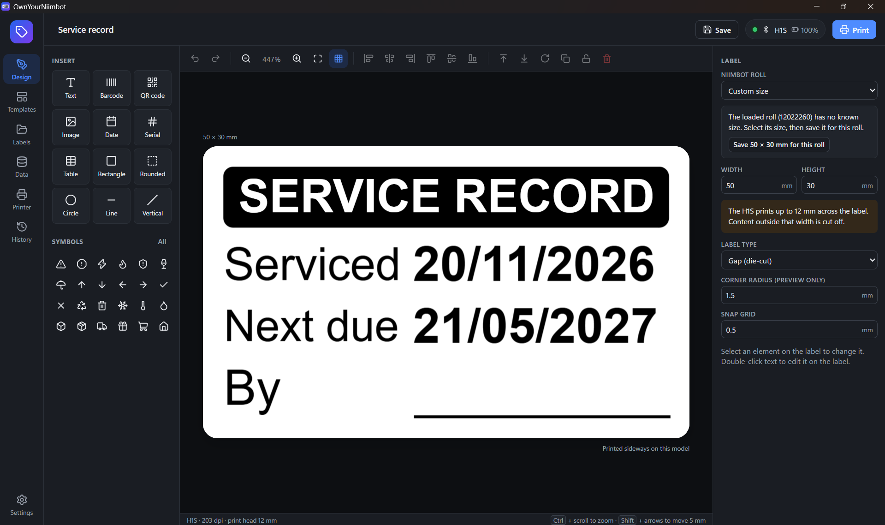
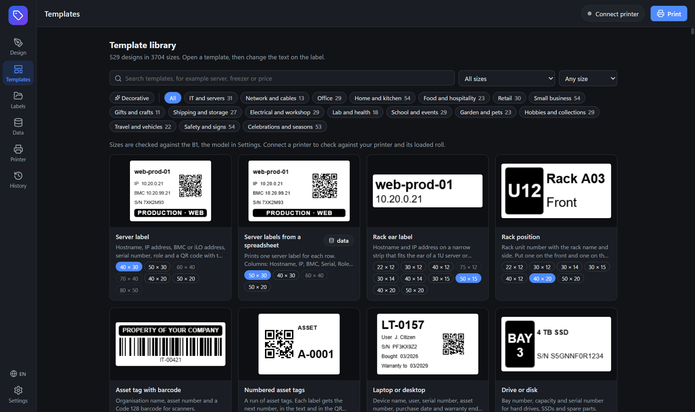
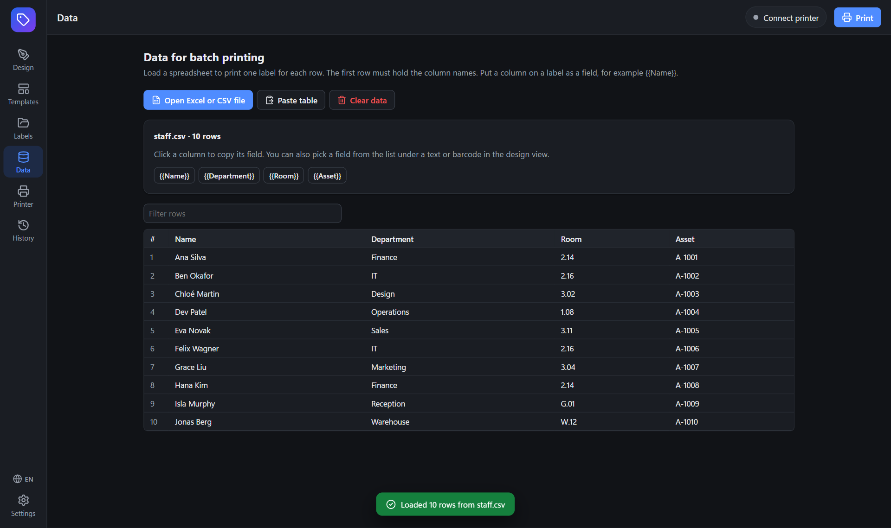
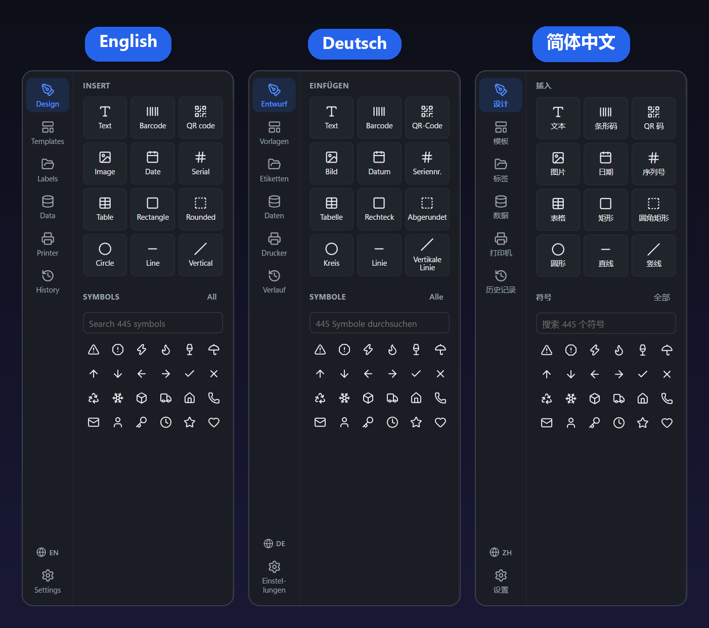

# OwnYourNiimbot


A free desktop app to design and print labels on NIIMBOT label printers (also searched for as Nimmbot or Niimbot printers). It runs on Windows, macOS and Linux, and connects to the printer over Bluetooth or a USB cable. No account, no cloud and no internet connection are needed.



## Features

- **Label editor**: text, barcodes, QR codes, Data Matrix, PDF417, Aztec, images, shapes, lines, tables and 571 symbols, which include 126 cute animals (koala, wombat, quokka, kangaroo, platypus and others, each with four expressions). Right-click an element to replace it with a different type. Double-click an image to put a new picture in its place.
- **Template library**: 532 ready-made designs for IT, cables, the kitchen, retail, shipping, the workshop, school, events and more, filtered to the printer and the roll that you use.
- **Batch printing**: one label for each row of an Excel, CSV or TSV file, or of a table that you paste.
- **Serial numbers and dates**: count up on each label, and calculate best-before or expiry dates.
- **Automatic label size**: the app reads the roll in the printer and sizes a new label to match.
- **Print area**: the editor shades the parts of the label that the print head cannot reach, and can fit the design inside.
- **Exact preview**: the print preview shows the dots that the printer receives.
- **Photos and logos**: conversion to black and white with dithering, threshold, brightness and contrast.
- **Printer status and settings**: battery, roll, labels left on genuine rolls, power-off time, sounds and calibration.
- **22 languages**: the app starts in the language of your system, and the globe button at the bottom of the side bar changes it.
- **AI assistants**: an optional local MCP server lets an assistant such as Claude make, preview and print labels.
- **Automatic updates** with a progress window, on Windows and Linux.

| Template library | Batch printing from a spreadsheet |
|---|---|
|  |  |



## Supported printers

The app works with 69 NIIMBOT (Nimmbot) models, including the D11, D110, D101, H1S, B18, B21, B1, B3S, B31, B32, K3, M2 and M3 series. [docs/supported-printers.md](docs/supported-printers.md) lists each model with its resolution, print width and label types.

## Install

Download the file for your computer from the [Releases](https://github.com/JakeSmithQUT/OwnYourNiimbot/releases) page.

| System | File |
|---|---|
| Windows 10 and 11 (x64 or Arm) | `OwnYourNiimbot-<version>-windows-<arch>-setup.exe` |
| Windows, no installation | `OwnYourNiimbot-<version>-windows-x64-portable.exe` |
| macOS (Apple silicon or Intel) | `OwnYourNiimbot-<version>-macos-<arch>.dmg` |
| Linux (x64 or Arm64) | `OwnYourNiimbot-<version>-linux-<arch>.AppImage` or `.deb` |

The app is not code signed, so the system warns you the first time that you open it. Download it only from the Releases page of this repository. `SHA256SUMS.txt` on each release has the checksums.

- **Windows**: start the installer. If SmartScreen shows "Windows protected your PC", click **More info**, then **Run anyway**. The installer has no questions: it installs the app for your user, adds shortcuts and opens the app.
- **macOS**: drag the app to Applications, then right-click it and click **Open**, and allow Bluetooth access when it asks. If macOS says that the app is damaged, run `xattr -dr com.apple.quarantine /Applications/OwnYourNiimbot.app` in Terminal.
- **Linux**: run `chmod +x OwnYourNiimbot-*.AppImage` and start the AppImage, or install the .deb package. Bluetooth needs BlueZ 5.41 or later. For a USB cable, add your user to the `dialout` group (`uucp` on Arch) with `sudo usermod -aG dialout $USER`, then log out and in again.

## Connect a printer

1. Turn on the printer. Close the phone app first: the printer accepts one connection at a time.
2. Click **Connect printer** at the top of the window.
3. Click **Bluetooth** and select the printer (its name starts with the model, for example `D110-`), or click **USB cable or serial port** and select its port.

The printer does not need to be paired in the system settings. The app remembers the last printer, so the label size and print area stay correct after a restart.

## Design and print a label

1. Click **New label** at the top of the **Design** page or on the **Labels** page, or press Ctrl+N. The app asks for the size and type of the label. Or start from a design on the **Templates** page.
2. Add elements from the **Insert** panel on the left. Select an element to change it in the panel on the right.
3. Click **Print**, check the preview, set the copies and the density, and click **Print**.

Press Ctrl+S to save the label. To keep a saved label and make a new one from it, change the name and save.

### Templates

The **Templates** page shows each design in the sizes that suit it. The list at the top shows the sizes that match the loaded roll, the NIIMBOT rolls for your printer, or every size. Click a size to open the design, then change the text.

Some templates count up on each label (asset tags, cable markers, raffle tickets) or calculate a date (use-by, next test). The templates use 19 included fonts, so labels look the same on every computer.

### Print area

On some printers the print head is narrower than the roll. For example, the H1S prints 12 mm across a 15 mm roll. The editor shades the parts that do not print. If an element goes outside the print area, the right panel shows a warning: click **Fit into the print area** to move and shrink the design to fit.

## Batch printing from a spreadsheet

Print one label for each row of a spreadsheet, for example name badges, asset tags or server labels.

**1. Prepare the data.** The first row holds the column names. For example, `staff.csv`:

| Name | Room | Asset |
|---|---|---|
| Ana Silva | 2.14 | A-1001 |
| Ben Okafor | 2.16 | A-1002 |
| Chloé Martin | 3.02 | A-1003 |

**2. Load it.** On the **Data** page, click **Open Excel or CSV file** and select the file (.xlsx, .csv or .tsv). Or copy the cells in Excel or Google Sheets and click **Paste table**. The page shows the rows, and a field button for each column, for example `{{Name}}`.

**3. Put the fields on the label.** In the design view, select a text, barcode or QR code element. In the right panel, pick a column in **Insert a data field**. The field shows as `{{Name}}` and you can mix it with normal text, for example `Room {{Room}}`. Put `{{Asset}}` in a barcode to encode the asset number.

**4. Print.** Click **Print**. Under **Data rows**, set **From** and **To** to the first and the last row to print. The arrows under the preview step through the labels. Set **Copies of each label** if you need more than one, then click **Print**.

Tips:

- A serial number field counts up across the batch, and a date field can add a number of days.
- The data is saved with the label (up to 5,000 rows), so a saved label opens with its data.
- One print job can have up to 10,000 labels. Print larger sets in parts with **From** and **To**.
- The **Server labels from a spreadsheet** template is a ready example with the columns `Hostname`, `IP`, `BMC`, `Serial` and `Role`.

## Change the language

The app starts in the language of your system if it has that language, else in English. To change it, click the globe button (for example **EN**) at the bottom of the side bar and select a language. The app keeps your choice. The app has English, Bulgarian, Chinese (Simplified and Traditional), Croatian, Czech, French, German, Hindi, Hungarian, Italian, Japanese, Korean, Marathi, Polish, Portuguese (Brazil), Russian, Spanish, Swedish, Turkish, Ukrainian and Vietnamese. You can also change it in **Settings**. Templates and symbol names stay in English.

## Label size detection

When a printer connects, and when you close the cover after you change the roll, the app gets the size of the loaded roll from the printer, from a size that you saved for that roll, or from the roll list in the app. A new, empty label changes to that size. If the app cannot find the size, select it in the **NIIMBOT roll** list and click **Save** under the list.

## Use with AI assistants (MCP)

An AI assistant on the same computer can make labels, look at a preview and print through the Model Context Protocol. The server is off by default.

1. Go to **Settings**, **AI assistants (MCP)**, and select **Allow AI assistants to use OwnYourNiimbot**.
2. Copy the setup for your assistant from the same section:
   - **Claude Code**: run the **Claude Code command** in a terminal.
   - **Claude Desktop**: add the JSON to `claude_desktop_config.json`, then restart Claude Desktop.
   - **Other MCP clients**: use `http://127.0.0.1:47821/mcp` with the header `Authorization: Bearer <token>`.

The assistant can list rolls and templates, create and edit labels, preview them as the printer prints them, save them and print them. It gets the print area of each label. The server accepts connections from this computer only and needs the token, and by default the app asks you before an assistant prints. After an app update, reconnect the assistant (in Claude Code, run `/mcp`).

## Updates

The installed app checks the [Releases](https://github.com/JakeSmithQUT/OwnYourNiimbot/releases) page when it starts and every 6 hours. On Windows and with the Linux AppImage, a small window shows the download, then the installer shows its progress and the app opens again with a **What's new** link. Click **Start without updating** to use the app while it downloads; a **Restart to update** button shows when it is ready. On macOS, with the portable Windows app and with the .deb package, a bar links to the new release. To turn off the check, go to **Settings**, **Updates**.

## Privacy

The app has no account, no analytics and no cloud service. The update check is its only internet connection: it asks GitHub for the latest release, and GitHub gets the app version and your IP address. Labels, history and settings stay in the app data folder (**Settings**, **Open data folder**).

## Build from source

You need Node.js 22 or later and Git.

```bash
git clone https://github.com/JakeSmithQUT/OwnYourNiimbot.git
cd OwnYourNiimbot
npm install
npm run dev
```

| Command | Result |
|---|---|
| `npm run dev` | Starts the app with live reload |
| `npm test` | Runs the tests |
| `npm run typecheck` | Checks the TypeScript types |
| `npm run build` | Builds the app into `dist/` |
| `npm run dist:win`, `dist:mac`, `dist:linux` | Builds the installers into `release/` |

[docs/development.md](docs/development.md) describes the project layout, translations, tests and the release procedure. [docs/protocol.md](docs/protocol.md) describes the printer protocol.

## Legal

OwnYourNiimbot is an independent project. NIIMBOT did not make, approve or support it. NIIMBOT is a trademark of its owner, and the name is used only to identify compatible printers. The repository contains no code, images, fonts, templates or translations from the official app. The included fonts and libraries keep their own licences ([THIRD_PARTY_LICENSES.txt](THIRD_PARTY_LICENSES.txt)).

## Licence

MIT. Refer to [LICENSE](LICENSE).
